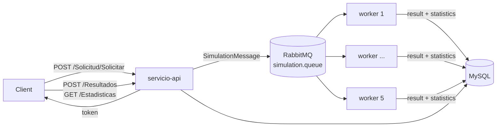

<p align="center"></p>

<p align="center">An asynchronous artificial-life simulation service: a Spring Boot REST API queues cellular-automaton simulations in RabbitMQ, a pool of workers runs them and MySQL stores the results.</p>

<p align="center">
  
  <a href="LICENSE"></a>
  <a href="https://santiagodie.com/life-simulation-service/"></a>
  <a href="https://santiagodie.com/life-simulation-service/doc/"></a>
</p>

## Table of Contents

- [About the Project](#about-the-project)
- [Live Demo](#live-demo)
- [Features](#features)
- [Built With](#built-with)
- [How It Works](#how-it-works)
- [API](#api)
- [Getting Started](#getting-started)
- [Tests and CI](#tests-and-ci)
- [Project Structure](#project-structure)
- [Known Limitations](#known-limitations)
- [Team](#team)
- [License](#license)
- [Contact](#contact)

## About the Project

Users submit a simulation request (a list of species and how many individuals each one starts with) and receive a token. The request is queued in RabbitMQ and picked up by one of several workers, which runs a cellular automaton on an 8×8 grid for 10 time steps: individuals move at random, eat each other according to a food chain defined by their colour, and reproduce after eating. The result and per-step population statistics are stored in MySQL, where clients can fetch them with the token.

The service is the back end of a two-part project. The browser front end that requests simulations and replays them on a grid is **[life-simulation-web-client](https://github.com/santiagodie/life-simulation-web-client)**.

> This was a **team project by a group of four** (see [Team](#team)).

## Live Demo

**[santiagodie.com/life-simulation-service](https://santiagodie.com/life-simulation-service/)**: the service's own web pages running as a static site (UI in Spanish, as in the original project):

- **Visualiser**: population charts and statistics for simulations recorded from the real service in both modes, plus new simulations run in your browser by a JavaScript port of the workers' simulation code. Given the same seed, the port produces exactly the same output as the Java code.
- **Worker dashboard**: a replay of real `/Dashboard/Stats` snapshots recorded while 100 requests were processed by 5 workers.

The full system (API, queue, workers and database) runs locally with Docker (see [Getting Started](#getting-started)). The Javadoc is published at **[santiagodie.com/life-simulation-service/doc](https://santiagodie.com/life-simulation-service/doc/)**.

## Features

- **REST API** generated from an OpenAPI 3 contract (`openapi.yaml`) with the delegate pattern, documented with Swagger UI.
- **Asynchronous processing**: each request becomes a message in `simulation.queue`; five worker replicas consume it in parallel, one message at a time (`prefetch=1`).
- **Two simulation modes**, selected with `SIMULATION_MODE`:
  - `standard`: circular food chain red → blue → green → yellow → orange → purple → red (each colour eats the next one).
  - `advanced`: red eats blue and green, blue and green eat yellow, yellow does not eat and red cannot be eaten; blue individuals that eat keep food to share with another blue one.
- **Statistics** per simulation: population of each colour at every step, the colour that grew the most, the one that ate the most (estimated from the decrease of its prey under the active mode's rules) and the dominant colour at the end.
- **Web pages** served by the API: a simulation visualiser and a live dashboard of the RabbitMQ queue and the connected workers.
- **Stress test script** that sends 100 concurrent requests.

## Built With

- Java 21, Spring Boot 3.3 (Web, Data JPA, AMQP), Maven multi-module build
- RabbitMQ 3 (with the management plugin), MySQL 8
- OpenAPI Generator, SpringDoc / Swagger UI
- JUnit 5, Mockito, H2 (tests)
- Docker and Docker Compose
- GitHub Actions (tests, Javadoc and GitHub Pages)

## How It Works



**Simulation.** Species are assigned colours in order (red, blue, green, yellow, orange, purple) and placed at random on the grid. At each step every individual moves to a random neighbouring cell. When two individuals of different species meet, the one that can eat the other according to the active mode takes the cell; if neither can, the newcomer moves to a free cell nearby. When two individuals of the same species meet and one of them has eaten, a new individual is born in a free adjacent cell.

**Result format.** The result stored for each request is plain text: the first line is the grid size and every following line is `time,row,column,colour` for one individual at one step.

**Modules.** `servicio-common` holds the JPA entities, repositories, message models and the statistics service; `servicio-api` is the REST application; `servicio-worker` is the RabbitMQ consumer that runs the simulations. The API and the workers are built from the same multi-stage `Dockerfile`.

## API

| Method | Path | Description |
| --- | --- | --- |
| `POST` | `/Solicitud/Solicitar?nombreUsuario=` | Create a simulation request; returns its token |
| `GET` | `/Solicitud/ComprobarSolicitud?nombreUsuario=&tok=` | Request status: `[1, 0]` finished, `[0, 1]` in progress, `[0, 0]` not found |
| `GET` | `/Solicitud/GetSolicitudesUsuario?nombreUsuario=` | Tokens of a user's requests |
| `POST` | `/Resultados?nombreUsuario=&tok=` | Result of a finished simulation |
| `GET` | `/Estadisticas?tok=` | Aggregated statistics of a simulation (`404` if there are none) |
| `GET` | `/Dashboard/Stats` | Queue depth, publish/deliver rates and active worker channels |
| `POST` | `/Email?emailAddress=&message=` | Email notification (see [Known Limitations](#known-limitations)) |

Example request body for `/Solicitud/Solicitar`:

```json
{
  "cantidadesIniciales": [10, 5, 8],
  "nombreEntidades": ["Rabbits", "Foxes", "Eagles"]
}
```

## Getting Started

### Prerequisites

- Docker with Docker Compose

To build or run the tests outside Docker you also need JDK 21 (the Maven Wrapper is included).

### Run with Docker Compose

```bash
git clone https://github.com/santiagodie/life-simulation-service.git
cd life-simulation-service
docker compose up --build
```

This starts MySQL, RabbitMQ, the API and five workers in `standard` mode. To use the advanced rules:

```bash
SIMULATION_MODE=advanced docker compose up --build
```

| Service | URL |
| --- | --- |
| Swagger UI | `http://localhost:8080/swagger-ui.html` |
| Simulation visualiser | `http://localhost:8080/simulacion.html` |
| Worker dashboard | `http://localhost:8080/dashboard.html` |
| RabbitMQ management | `http://localhost:15672` (guest / guest) |

The credentials in `docker-compose.yml` are local development defaults.

To send 100 concurrent requests and watch them on the dashboard:

```bash
bash stressTest.sh
```

To use the service from a browser front end, start [life-simulation-web-client](https://github.com/santiagodie/life-simulation-web-client) on port 8081.

### Rebuild the demo site

```bash
./mvnw -B install -DskipTests
./mvnw -B javadoc:aggregate
bash demo/build-site.sh _site
```

## Tests and CI

```bash
./mvnw test
```

The suite covers the services, the API delegates and controllers, the simulation engine (including regression and border cases) and persistence. Tests run against an in-memory H2 database, so no MySQL or RabbitMQ is needed.

GitHub Actions workflows:

| Workflow | Trigger | What it does |
| --- | --- | --- |
| Test and Promote | push to `main` | Runs the tests and fast-forwards `early` to `main` if they pass |
| Validate Javadoc | push to `early` | Checks that the Javadoc builds |
| Build and Deploy Pages | after Test and Promote succeeds on `main`, or manually | Builds the demo and the Javadoc and publishes them to GitHub Pages |

## Project Structure

```
pom.xml                    # Parent POM (modules: common, api, worker)
Dockerfile                 # Multi-stage build with targets api and worker
docker-compose.yml         # MySQL + RabbitMQ + API + 5 workers
init.sql                   # MySQL schema, loaded by the MySQL container
stressTest.sh              # 100 concurrent simulation requests
servicio-common/           # JPA entities, repositories, message models, EstadisticasService
servicio-api/
├── src/main/java/...      # REST controllers (OpenAPI delegates), services, RabbitMQ and Swagger config
└── src/main/resources/
    ├── openapi.yaml       # API contract
    └── static/            # simulacion.html (visualiser) and dashboard.html
servicio-worker/           # SimulationListener and the standard / advanced simulation services
demo/                      # Static demo for GitHub Pages: demo layer, JavaScript port, recorded data
```

## Known Limitations

- `/Email` validates the address but does not send anything; there is no mail server behind it.
- Grid size (8×8) and the number of steps (10) are constants in the simulation services.
- The simulation mode applies to the whole deployment: the API and every worker must use the same `SIMULATION_MODE`.
- Simulations are not seeded, so the same request gives a different result each time. The demo's JavaScript port accepts a seed to make results reproducible.

## Team

- Ana Nicolás Lacalzada ([@annicol8](https://github.com/annicol8))
- Lucas Alonso Fernández ([@lucasaf04](https://github.com/lucasaf04))
- Clara Hernández Calleja ([@clhernca](https://github.com/clhernca))
- Santiago Die Morejón ([@santiagodie](https://github.com/santiagodie))

See also [CONTRIBUTORS.md](CONTRIBUTORS.md).

## License

Released under the [MIT License](LICENSE).

## Contact

Santiago Die · [GitHub](https://github.com/santiagodie) · [LinkedIn](https://www.linkedin.com/in/santiago-die-morejon)

---

Built for the Cross-disciplinary Workshop I: Programming and Information Processing course at the University of La Rioja (2025–26).
